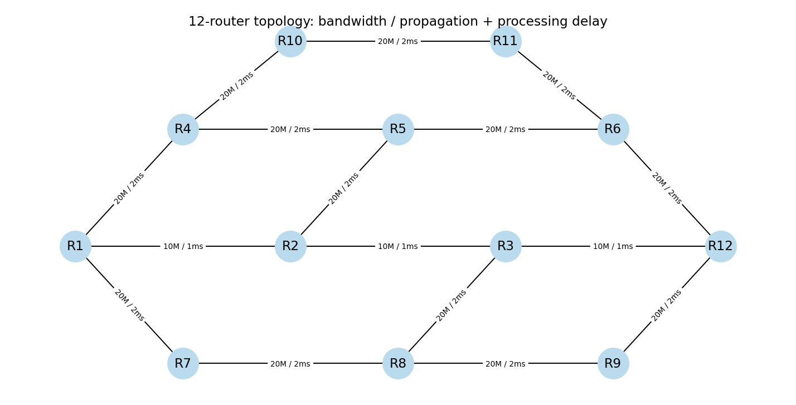
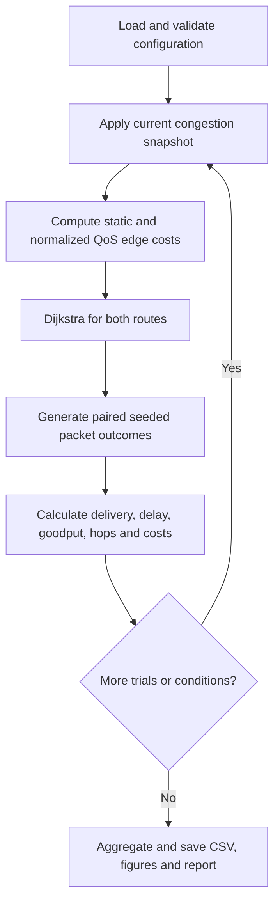
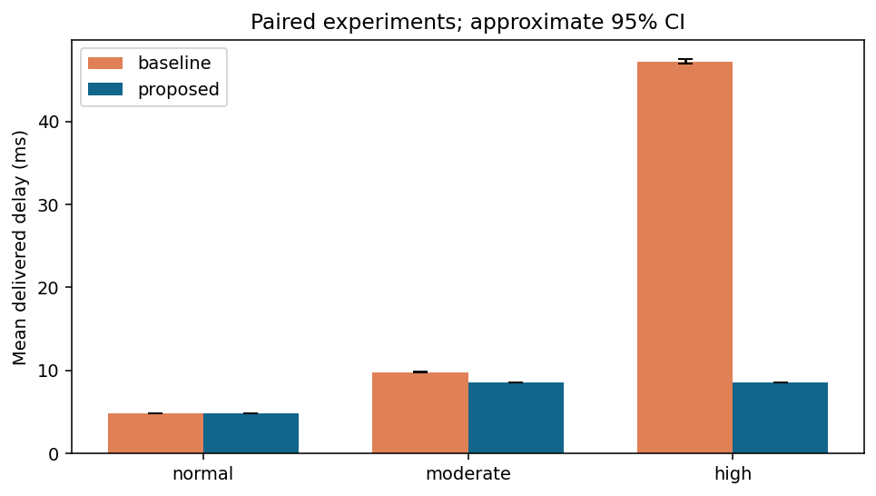
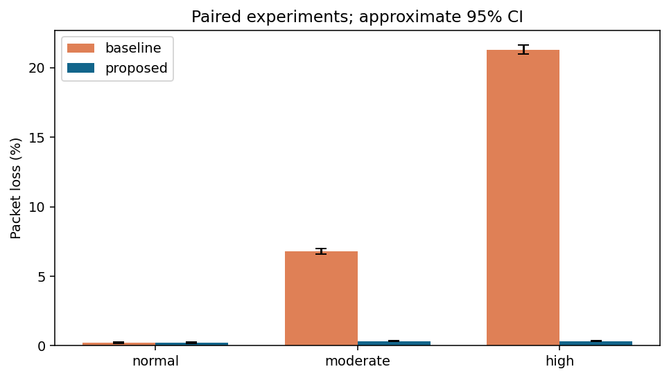
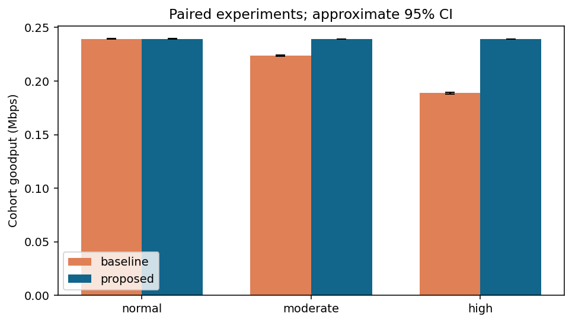
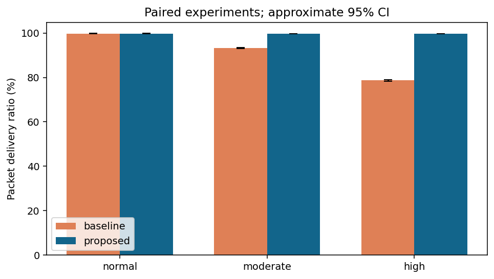
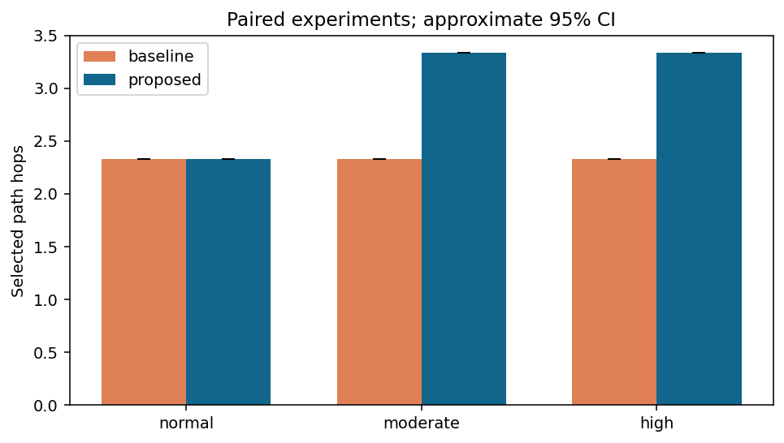
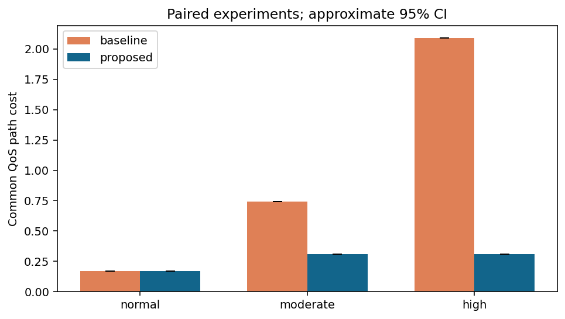
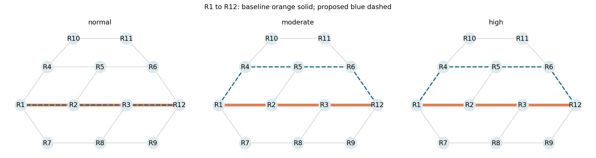
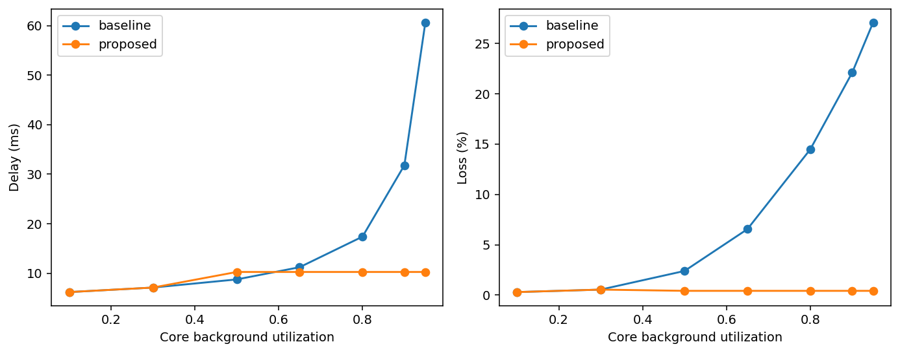

# QoS-Aware Adaptive Routing for Improved Network Performance under Congestion

Computer Networks Lab BCSE308P — project report.

## Abstract

This project compares a QoS-aware weighted Dijkstra heuristic with hop-count shortest-path routing on a synthetic 12-router network. Link delay, loss, utilization and hop penalties are normalized and combined with configurable weights. Three congestion conditions and three source–destination pairs are evaluated using 30 reproducible trials per pair. Under high congestion, mean delivered delay decreases from 47.22 ms to 8.55 ms and packet loss from 21.30% to 0.33%, at the cost of one additional hop on average. Normal-condition results are unchanged. A separate Packet Tracer guide demonstrates conventional IPv4/OSPF routing; its manual execution remains pending. The results show a trade-off within the configured model, not guaranteed improvements in deployed networks.

## Introduction

Routing determines which links a packet traverses. A route with few hops can become undesirable when its links carry heavy background traffic. Delay and packet delivery therefore depend on link conditions as well as topology. This project connects shortest-path algorithms to packet-switching performance through a small, explainable simulation and a separate router demonstration.

## Problem statement

Given a connected topology, source and destination, and changing link-state attributes, compare the route chosen by static hop count with one chosen by a configurable QoS cost. Measure whether the second route improves relevant performance metrics and identify the cost of any improvement. Keep traffic, network state and packet randomness paired so differences arise from route selection rather than different workloads.

## Objectives

1. Implement a literature-grounded scalar QoS routing heuristic with nonnegative costs.
2. Compare it with unit-cost Dijkstra under normal, moderate and high external congestion.
3. Measure delay, loss, cohort goodput, delivery ratio, route hops and both path costs.
4. Demonstrate route changes and recovery, quantify sampling uncertainty and disclose limitations.
5. Provide a small conventional OSPF/ICMP Packet Tracer demonstration without claiming the custom algorithm runs there.

## Existing work and literature basis

Implement a literature-grounded QoS routing model and measure its behavior against conventional shortest-path routing under controlled congestion. The primary basis is **RFC 2676**, which describes QoS link-state information and resource-aware path computation, including a Dijkstra approach. This project adopts its collect-state → compute-path → update-path framework, substituting an explicitly student-designed normalized weighted cost. It does not claim an exact reproduction or a new routing protocol.

### Verified references

1. George Apostolopoulos, Doug Williams, Sanjay Kamat, Roch Guerin, Ariel Orda, and Tony Przygienda, *QoS Routing Mechanisms and OSPF Extensions*, RFC 2676, August 1999, Experimental. DOI: [10.17487/RFC2676](https://doi.org/10.17487/RFC2676). [Full text](https://www.rfc-editor.org/rfc/rfc2676). **Primary technical reference.** It motivates using changing link-state resources to select paths. This project does not implement its signaling or resource reservation.
2. Zheng Wang and Jon Crowcroft, “Quality-of-Service Routing for Supporting Multimedia Applications,” *IEEE Journal on Selected Areas in Communications*, vol. 14, no. 7, pp. 1228–1234, September 1996. [Published paper record](https://ieeexplore.ieee.org/document/536364), [author-hosted manuscript](https://www.cl.cam.ac.uk/~jac22/otalks/wang96quality.pdf). It discusses multi-metric routing and explicitly cautions that a mixed metric is only a path-selection indicator. That caveat applies to this project: a low weighted cost does not guarantee separate delay/loss bounds.

## Gap identified

The gap is in the **chosen baseline**, not an unresolved gap in all networking research: static hop count does not respond to changing congestion. The project addresses that teaching gap by recomputing a QoS-weighted route from current link state and showing measured trade-offs. It does not claim that existing QoS routing literature ignores these issues.

## Architecture

```text
config.json → model.py: topology and current link attributes
                        ↓
              baseline / QoS Dijkstra
                        ↓
              simulation.py: packet outcomes
                        ↓
run.py: paired trials → CSV + statistical summary → plots.py: figures
```

NetworkX supplies graph representation and Dijkstra. Python's standard random module supplies seeded packet variates. Matplotlib renders actual computed results. Modules separate link modeling, route choice, traffic measurement and presentation.

## Network model: topology and traffic



There are 12 routers and 16 undirected links. The central R1–R2–R3–R12 corridor has three hops, 10 Mbps links and 1 ms propagation/processing delay per link. Upper and lower bypasses offer four hops, 20 Mbps and 2 ms per link; crosslinks provide further choices. All parameters are in `config.json`. This is a synthetic campus/backbone-style topology, not a measured deployment.

Each independent experiment generates 1,000 fixed-size 1,200-byte UDP-like packets at 25 packets/s (0.24 Mbps) over a 40 s generation interval. Packets are followed until delivered or dropped. The three source/destination pairs are run separately, not as concurrent competing flows. There are no acknowledgments, retransmissions, TCP windows or protocol headers in this abstraction.

Core external utilization is 0.10, 0.70 and 0.95 for normal, moderate and high conditions. Other links stay at 0.15. This intentionally represents a congested primary corridor with spare alternate capacity. It favors adaptation when that spare capacity exists; it is not evidence of universal superiority.

## Link model

For packet size L bits, bandwidth B bits/s and external utilization u:

- Transmission service time s = L/B (convert seconds to ms).
- Mean queue delay q = s·u/(1−u).
- Estimated link delay d = propagation/processing delay + s + q.
- Effective drop probability p = 1−(1−p_base)(1−k·u⁴), with configurable k=0.12.
- Sampled queue wait W = −q·ln(1−U), U uniform on [0,1).

The mean-queue expression is inspired by a simple queueing approximation; exponential waiting is a modeling choice, not an exact M/M/1 waiting-time distribution. The loss curve is a declared synthetic congestion law, not a fitted physical law. Queues, packet contention and buffer occupancy are not explicitly simulated. Routing does not feed back into external utilization; the offered flow is treated as a probe workload. Avoid extrapolating to large offered loads.

## Proposed methodology

For each externally supplied network-state snapshot, calculate link delay/loss estimates and normalized edge costs, choose routes, then sample paired packet outcomes. Route selection uses the model's expected link attributes, not future sampled packet outcomes. A separate epoch sequence demonstrates recomputation after changes. Configuration fields and units are fully listed in [CONFIGURATION.md](CONFIGURATION.md).

### Baseline algorithm

Baseline uses Dijkstra with cost 1 per edge. It minimizes hops. It represents conventional static-cost shortest-path behavior, not a complete OSPF implementation. Its metrics are evaluated under the same changing link conditions as the proposed route.

### QoS cost formulation

Proposed edge cost is:

```text
D = min(d / 20 ms, 1)
P = min(−ln(1−p) / −ln(1−0.10), 1)
U = u
H = 1 / (N−1)
edge_cost = 0.40 D + 0.30 P + 0.20 U + 0.10 H
path_cost = sum(edge_cost along path)
```

Weights and reference scales are configurable. Fixed reference scales keep conditions comparable; clipping avoids a single large term dominating, but sacrifices resolution above the threshold. The hop component sums to hops/(N−1) for simple paths. The additive negative-log success term respects multiplicative link reliability before clipping: actual path loss is 1−product(1−p), not the sum of edge loss probabilities. Delay and utilization are correlated, so their weights intentionally reinforce congestion avoidance; they are not independent statistical features.

### Proposed algorithm

Compute the QoS cost on every edge and call Dijkstra with that cost as the edge weight. Reconstruct the minimum-cost source-to-destination path. Recompute on every state update. The baseline also calls Dijkstra, but with unit edge costs. All edge costs are nonnegative, so Dijkstra applies. It finds the minimum of this scalar heuristic, not an exact multi-constraint optimum. A heap-based Dijkstra has typical complexity O((V+E) log V). For this small topology, recomputation is inexpensive; signaling overhead is excluded. Packet simulation adds O(PH) work for P packets and a selected path of H edges.

## Pseudocode

```text
validate configuration
for each condition:
    build graph from current link-state snapshot
    for each source/destination pair and independent trial seed:
        baseline_path ← Dijkstra(graph, unit edge weights)
        qos_path ← Dijkstra(graph, normalized QoS weights)
        for each algorithm's path:
            for each generated packet:
                for each edge in path:
                    obtain shared seeded loss/wait random values
                    if loss value < edge drop probability: drop; stop packet
                    accumulate propagation + transmission + sampled wait
                if all edges traversed: count delivery and total delay
            calculate metrics; write trial row
aggregate pairs within trial, then trials with uncertainty intervals
recompute routes at normal → moderate → high → normal epochs
save figures, CSV files and report
```

## Flowchart

Flowchart description: start with configuration validation, apply the current congestion state, compute both routes, generate paired packet outcomes, and calculate metrics. Repeat over trials and conditions, then aggregate and export the results. The separate dynamic experiment repeats route computation at each epoch; it does not carry queue state between epochs.



## Metrics and statistics

Let S be sent packets, R received packets, T=S/rate and L packet bits:

| Metric | Definition |
|---|---|
| Average end-to-end delay | Sum of delivered packet delays / R; NaN if R=0 |
| Packet loss percentage | 100(S−R)/S |
| Packet delivery ratio | 100R/S |
| Throughput / cohort goodput | RL/T / 10⁶ Mbps |
| Average hop count | Mean selected route edge count across experiments |
| Static path cost | Sum of unit link costs |
| QoS path cost | Sum of current QoS edge costs, evaluated for both algorithms |

Goodput follows the entire generated cohort through completion, including arrivals after the generation interval. It is not a fixed receive-window throughput measurement or a capacity estimate. Hop count measures chosen routes, not hops traveled by dropped packets. Both costs are reported separately; comparing baseline's static cost directly to proposed's QoS cost would be invalid. Delay is conditional on delivery, which can introduce survivorship bias.

## Experimental setup and statistical aggregation

Thirty trial seeds per pair × three pairs × three conditions × two algorithms = 540 trial rows, plus a seven-level sweep and dynamic trace. Each algorithm uses identical packet/link random variates on shared links; independent streams separate trial/pair combinations. This reduces comparison noise. Common seeds across congestion levels also support controlled comparisons.

For each condition, average the three pair results within each trial, then report the mean and approximate 95% interval mean ±1.96·sample_SD/√30. These are normal approximations, not exact small-sample t intervals. Paired differences use proposed−baseline within each trial before computing uncertainty. They quantify packet sampling noise only, not uncertainty in topology, weights or model assumptions. Path/hop costs are deterministic and therefore have zero sampling intervals.

## Results

The following table is the average across all three independently simulated pairs, not the first-pair sweep. Values are rounded to four decimals from `results/summary.csv`. Throughput denotes cohort payload goodput in Mbps. Static path cost equals hop count because every baseline edge has cost 1; the QoS column evaluates the common QoS objective for both algorithms.

| Condition | Algorithm | Delay ms | Loss % | Goodput Mbps | PDR % | Hops | QoS cost | Static cost |
|---|---|---:|---:|---:|---:|---:|---:|---:|
| normal | baseline | 4.8223 | 0.2278 | 0.2395 | 99.7722 | 2.3333 | 0.1711 | 2.3333 |
| normal | proposed | 4.8223 | 0.2278 | 0.2395 | 99.7722 | 2.3333 | 0.1711 | 2.3333 |
| moderate | baseline | 9.8057 | 6.8089 | 0.2237 | 93.1911 | 2.3333 | 0.7448 | 2.3333 |
| moderate | proposed | 8.5490 | 0.3267 | 0.2392 | 99.6733 | 3.3333 | 0.3114 | 3.3333 |
| high | baseline | 47.2155 | 21.3000 | 0.1889 | 78.7000 | 2.3333 | 2.0879 | 2.3333 |
| high | proposed | 8.5490 | 0.3267 | 0.2392 | 99.6733 | 3.3333 | 0.3114 | 3.3333 |













Read `../results/FINAL_RESULTS.md` and `../results/paired_differences.csv` for executed numbers. Normal conditions may yield the same path and identical results. Congestion can make the adaptive method use extra hops to reduce delay and drops. PDR and loss are complements; at fixed offered load, goodput also follows delivery ratio. These are related measures, not three independent demonstrations of improvement.

### Separate sweep and dynamic-route experiment

The dynamic trace uses R1–R12 only, through four state epochs, and recomputes routes on each update. Its single seeded run per algorithm/epoch is not a 30-trial condition average. Packets finish within an epoch's frozen state; it does not model packets crossing a state transition or routing convergence delay. The baseline stays on R1–R2–R3–R12. The proposed route changes to R1–R4–R5–R6–R12 under moderate/high congestion and returns to the baseline path at recovery.



The sweep also uses R1–R12 only, averaging 30 trials at each of seven utilization levels. At utilization 0.95, delay is 60.6218 ms baseline versus 10.2586 ms proposed; loss is 27.0867% versus 0.4233%. These values differ from the three-pair summary because they concern a different aggregation scope. See [RESULTS_SUMMARY.md](RESULTS_SUMMARY.md) for the complete sweep table.



The R1–R12 congestion sweep also exposes a trade-off at utilization 0.50: the weighted method can select the bypass before it has lower delay, because it also values lower loss and utilization. The delay curve is therefore not uniformly better. The sweep uses only the first pair, whereas the summary table averages all three pairs.

## Discussion and trade-offs

Normal routes coincide, so paired randomness yields exactly identical results. At moderate congestion the delay reduction is 12.82%; at high congestion it is 81.89%. High loss falls by 20.97 percentage points, while average hops rise by 1.00. Proposed moderate and high values coincide because their selected bypass links and trial seeds coincide and the bypass state is unchanged.

The configured experiment places congestion on the short corridor and preserves spare capacity elsewhere. That mechanism explains the improvement; it does not establish the method as superior for arbitrary networks. The weighted objective can favor lower loss/utilization despite worse delay at some sweep settings. Confidence intervals in the CSV quantify random packet variation under fixed assumptions, not uncertainty about the model's realism. The tests verify routing optimality for the chosen scalar weights, accounting and reproducibility, not real-world validity.

## Limitations

The topology, load and loss law are synthetic. Exact current link state is assumed. There is no distributed discovery, routing advertisement delay, route-change overhead, hysteresis, queue feedback, concurrent traffic, packet reordering, TCP congestion control, flow control, ARQ or checksum model. Weights are selected for a teaching example, not statistically optimized. Longer paths need not always help, and alternate paths may also congest.

## Conclusion

The implementation demonstrates that a configurable QoS cost can select a healthier, longer route and improve appropriate metrics under the chosen external-congestion scenario. It also demonstrates equal normal-condition performance and a delay-versus-loss trade-off in the sweep. The appropriate claim is a reproducible educational comparison based on existing QoS-routing ideas, not a novel protocol or a deployment guarantee. Packet Tracer remains a separate ordinary-OSPF visual demonstration requiring manual execution.

## Future scope

Discrete-event finite-buffer queues; concurrent flows; stale metric sampling; route hysteresis; weight/reference-scale sensitivity; additional randomized topologies; TCP traffic in ns-3 or Mininet; measured link traces; control-plane overhead and fairness. These are proposed extensions, not completed features.

## Syllabus alignment

The simulation directly covers topology, packet switching, transmission time, shortest-path/link-state concepts, congestion, traffic management and QoS performance analysis. Packet Tracer adds classless IPv4 addressing, OSPF, ICMP and packet-path inspection. UDP-like traffic is modeled; TCP and distance-vector routing are comparison topics for viva only. Wireshark packet fields and error/flow control can be explained, but no Wireshark capture or TCP/ARQ implementation is claimed.

## References

The two research references, full author lists, publication metadata, verification sources and exact project mappings appear in [LITERATURE.md](LITERATURE.md). RFC 2676 is the primary framework reference; Wang and Crowcroft supplies multi-metric theory and the mixed-metric limitation. Cisco's two command-reference chapters support only the Packet Tracer configuration/verification guide. No third research paper is needed to support the implemented scope.
